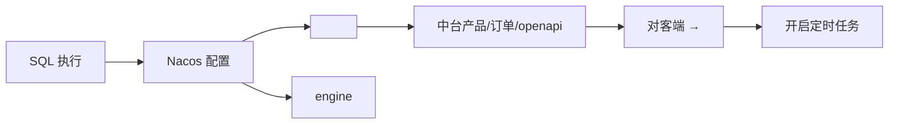

# 发布文档模板

> **用途**：把「这次上线要做什么、按什么顺序做、出问题怎么退」写成可执行的发布单（`09-release-doc.md`），发布当晚照着做。
> **与 03 技术方案的分工**：技术方案 §五「监控与发布」写方案层（指标设计、灰度思路、回滚方向）；本文档写执行层（具体 SQL、具体配置值、具体 CMDB 任务、具体勾选动作）。
> **章节约定**：`[必填]` / `[选填]` / `[有则必填]`（无变更时写明"本次无变更 + 已核对方式"）。

> ## 写作铁律（写之前先读，违反即重写）
>
> 1. **正文只写事实与动作**。禁止出现以下内容：
>    - 元说明：「本文只写发布与运维需要的事实」「接口契约见设计文档，本文不再重复」这类交代文档定位的话——读者看标题就知道；同一句不许出现两次。
>    - 变更史：「（2026-11-12 更新：文档按发布视角重构，移除…新增…）」——属于 commit message 或文档变更记录表。
>    - 思考过程、排除路径、「为什么要这样写文档」的论证。
> 2. **不给三环境坐标大全**。入口域名、DB 主机、Nacos 地址这类"三列大表"不进发布文档——运维手上有环境清单。只写**同一份发布内容在不同环境取值不同**的地方（§3.1）。
> 3. **Story 只给链接和标题**，不复制 PRD 内容、不铺仓库分工矩阵。要追细节点链接。
> 4. **能用一句结论就不用表**。表只用来放"要照着执行的清单"。
> 5. 示例值（`<!-- 例如：... -->`）填充时整行替换，不留痕。

---

| 字段 | 值 |
|------|-----|
| 需求 | <!-- 例如：REQ-1234 示例需求（对客端 + 中台侧） --> |
| 发布分支 | <!-- 例如：各仓库统一 feature/<req-branch> → test；发布统一拉 test --> |
| 发布窗口 | <!-- 例如：2026-11-14 22:00–23:30 --> |
| 发布负责人 | <!-- 谁执行 --> |
| 回滚决策人 | <!-- 谁有权喊停，写人 --> |
| 值守人 / 通知群 | <!-- --> |

---

## 一、需求

### 1.1 Story `[必填]`

> 只给链接 + 标题；需要备注的（如已砍、含补充需求）写在备注列。不要铺 PRD 列、仓库分工列。

| Story | 标题 | 备注 |
|-------|------|------|
| <!-- [<wiki-id>](wiki 链接) --> | <!-- 【示例需求】允许二级流通代币 --> | <!-- 中台 + 对客端 --> |
| <!-- [7130586632](链接) --> | <!-- 【Big交易】产品价格/净值管理 --> | <!-- 🔴 已砍，不在本次范围 --> |

**补充需求**（无评审 Story 但已落地的）：<!-- 一行一条，如：发行链新增 Robinhood 枚举并支持自托管产品下单，已评审通过 -->

### 1.2 发布内容摘要 `[必填]`

> 一段话 + 要点清单讲清"这次发出去用户/运营能感知到什么变化"。每条能对应到 §1.1 的 Story 或 §六 的验收用例，不写实现细节。

<!-- AI:auto:从 Controller/Service 变更 + 已合入 commit 推导，一条一个可验证行为 -->

- <!-- 例如：对客端新增「按钱包查可赎回份额」，无持仓钱包返回 0，不再进冻结环节才失败（ST 7130985163） -->
- <!-- 例如：下单成功初始状态由 INIT 改为 ACCEPTED；合适性匹配改取真实投资者类型 -->
- <!-- 例如：留痕文件改为异步生成后由 <file-sync-job> 补推 -->

**本次不含**：<!-- 例如：订单列表不展示交易账户/收付款账户名称，只保留账号与类型 -->

---

## 二、发布应用与依赖关系 `[必填]`

### 2.1 应用清单 `[必填]`

<!-- AI:auto:一个服务一行；job_id、应用分组、镜像/commit 需人工核对回填 -->

| 顺序 | 服务 | CMDB job | 应用分组 | 分支 | 说明（是否必须重发 / 已发记录） |
|------|------|---------|---------|------|------------------------------|
| 1 | <!-- <cash-service> --> | <!-- <job-id> --> | <!-- <app-group> --> | test | <!-- 已于 <date> 发布成功（<record-id>） --> |
| 2 | <!-- <product-service> --> | <!-- <job-id> --> | <!-- <app-group> --> | test | <!-- 需重发 --> |

> **发布权限**：CMDB 按应用分组授权，同一 session 可能只能发其中一组。报 `UmUser matching query does not exist` 先核对账号是否在该 job 授权名单，不要误判为 session 过期。

### 2.2 发布顺序与硬约束 `[必填]`

> 顺序结论写死，发布当晚不许临场改。依赖图只在跨系统链路复杂时画。

| 约束 | 结论 |
|------|------|
| 库先行还是码先行 | <!-- 例如：SQL 必须先执行，否则新版本启动即报 Unknown column --> |
| 配置先行还是应用先行 | <!-- 例如：Nacos 必须先配，<config-key-1> / <config-key-2> 在对应服务发布前配好 --> |
| 共享库变更的下游重发 | <!-- 例如：ChainEnum 在 <shared-pojo-module>，依赖它的 product / openapi / counter-account 必须同批重发 --> |
| 跨系统谁先上 | <!-- 例如：中台先于对客端（对客端调中台新端点） --> |
| 定时任务开启时机 | <!-- 例如：<file-sync-job> 必须在中台 <order-service> 发布后再开 --> |



### 2.3 依赖系统核对 `[必填]`

| 依赖 | 需要的能力 | 状态 | 谁确认 |
|------|-----------|------|--------|
| <!-- 例如：<external-pdf-service>（外部） --> | <!-- 留痕文件生成接口 --> | <!-- 已就位 / 待确认 --> | <!-- --> |

> 任一依赖未就位 = 发布阻塞项，写进 §六 T-1，不允许"发布后再说"。

---

## 三、发布内容 `[必填]`

### 3.1 按环境替换的值 `[有则必填]`

> **只列各环境取值不同的项**（配置域名、密钥、链网络、账号、执行器地址）。三环境完全一致的不进表。三环境坐标（入口域名 / DB 主机 / Nacos 地址）不写。

| 配置项 | SIT 现值 | 各环境差异与风险 |
|--------|---------|----------------|
| <!-- <config-key> --> | <!-- https://<api-gateway>/<file-endpoint>?fileId= --> | <!-- 生产必须换 <api-gateway> 生产域名；未配时代码保留上游原值并 warn，不会拼出半截地址 --> |
| <!-- <inner-api-signature-key> --> | <!-- 各环境独立密钥 --> | <!-- 串环境即 401 --> |
| <!-- xxl-job 执行器地址 --> | <!-- SIT 调度中心 --> | <!-- 生产必须用生产调度中心；本地实例 xxl.job.enabled 未关会注册进执行器组导致旧代码抢跑 --> |

**枚举 / 代码映射的多环境对照** `[有则必填]`——凡"DB 配置 + 代码映射必须同时对齐"的，逐层列全：

| 层 | 位置 | SIT 值 | 生产值 |
|----|------|--------|--------|
| <!-- 产品枚举 --> | <!-- ChainEnum.ROBINHOOD --> | <!-- ROBINHOOD --> | <!-- 同 --> |
| <!-- 主网码映射 --> | <!-- RwaMainnetNetworkCodeMapper --> | <!-- Robinhood-Testnet --> | <!-- 🔴 必须改 Robinhood-Mainnet --> |
| <!-- chainId 兜底 --> | <!-- XxxServiceImpl#FALLBACK_CHAIN_ID --> | <!-- Robinhood-Testnet → 46630 --> | <!-- 键与值都要换 --> |

> 写清匹配规则（如"两级精确等值，键写错即查不到，最终抛未找到网络配置"），这是当晚最容易漏的一环。

### 3.2 数据库 `[有则必填]`

> **先讲清分库矩阵**：哪些表在哪个实例、哪些表按租户各执行一次。漏一个租户就是该租户 500。

| 库 / 实例 | 表 | 涉及租户 | 执行范围 |
|-----------|----|---------|---------|
| <!-- 10.36.0.170 --> | <!-- t_<req>_product_detail --> | <!-- flf / fxcf / hh --> | <!-- 三库各执行一次 --> |
| <!-- 10.36.1.87 finhub_order --> | <!-- <order-table> --> | <!-- 单库 --> | <!-- 一次 --> |

#### 3.2.1 现状核对（执行前先跑）`[必填]`

<!-- AI:auto:给出逐列 diff / COUNT 的核对 SQL；提醒 COUNT(*) 会绕过错列，必须全列 SELECT -->

```sql
-- <!-- 例如：逐列核对，缺列在此暴露 -->
SELECT COLUMN_NAME FROM information_schema.COLUMNS
WHERE TABLE_SCHEMA = '<库>' AND TABLE_NAME = 't_<req>_customer_order'
ORDER BY ORDINAL_POSITION;
```

#### 3.2.2 DDL `[有则必填]`

| # | 库 / 表 | 变更 | 可回滚 | 锁表风险 | 执行顺序 |
|---|--------|------|--------|---------|---------|
| 1 | <!-- --> | <!-- 加列 allow_secondary_circulation --> | 是 | 低 | <!-- B-2 → C → D（hh） --> |

```sql
<!-- AI:auto:DDL 原文，逐段标明所属库与租户 -->
```

**🔴 执行顺序**（不同库脚本不可互换，重跑会报错）：

| 库 | 执行脚本 | 备注 |
|----|---------|------|
| <!-- fxcf_wealth_order --> | <!-- 只跑 B-1 --> | <!-- 新列已在，只删残留旧列 --> |
| <!-- hh_wealth_order --> | <!-- B-2 → C → D --> | <!-- 完整改造 --> |
| <!-- flf_wealth_order --> | <!-- 无需执行 --> | <!-- 重跑 B-2 会因找不到 shortfall_amount 报错 --> |

#### 3.2.3 DML / 存量迁移 `[有则必填]`

| # | 用途 | SQL | 影响行数 | 前置校验 | 执行后自检 |
|---|------|-----|---------|---------|-----------|
| 1 | <!-- 回填 trade_pricing_mode --> | <!-- 见下 --> | <!-- 预计 N --> | <!-- 应返回 N --> | <!-- 应返回 0 --> |

> **铁律**：DML 必须幂等可重跑（`WHERE NOT EXISTS` / 唯一键防重），顺序不可乱（先加列 → 再迁移 → 再发应用）。删列/改名列不可逆，先跑预览 + 备份。

#### 3.2.4 明确不做的 DB 动作 `[选填]`

| 项 | 结论 |
|----|------|
| <!-- 例如：t_<req>_issuer_settlement_task 等三张结算表 --> | <!-- 已随代码下线，代码零引用，**不要创建** --> |

### 3.3 Nacos `[有则必填]`

#### 3.3.1 变更清单

| # | namespace | group | DataId | 变更类型 | SIT 状态 | 生产动作 |
|---|-----------|-------|--------|---------|---------|---------|
| 1 | <!-- <wealth-platform> --> | <!-- <wealth-platform> --> | <!-- <product-service>.yaml --> | 修改（新增 key） | ✅ 已配 | 换生产域名 |

#### 3.3.2 逐项明细

**① `<DataId>` — <!-- 用途 -->**

| 项 | 值 |
|----|-----|
| namespace / group | <!-- --> |
| 影响服务 | <!-- --> |
| 变更前 | <!-- --> |
| 变更后 | <!-- YAML/JSON 段，可整段粘贴 --> |

```yaml
<!-- AI:auto:配置段原文 -->
```

**生效方式与验证**：<!-- 例如：非热更新需重启 / @RefreshScope 立即生效；验证 SQL 或日志 -->

#### 3.3.3 本次零变更 `[选填]`

> 只列评审时会被问到的项，并给出"已核对"的依据。不要为填满工单而提交。

| 配置 | 结论 | 依据 |
|------|------|------|
| <!-- finloop.auth.exclude --> | 不改 | <!-- 新接口需登录态 --> |

### 3.4 定时任务 `[有则必填]`

<!-- AI:auto:扫描 @XxlJob，取 jobHandler 名与依赖表 -->

| Job（@XxlJob） | 用途 | 依赖 | 开启时机 / 频率 | 注意 |
|---------------|------|------|----------------|------|
| <!-- <file-sync-job> --> | <!-- 订单文件补推 中台 --> | <!-- <sync-status-column> --> | <!-- 中台发布后开，1~5 分钟 --> | <!-- 开早了报 Unknown column --> |

**明确不开启的任务**：

| Job | 结论 |
|-----|------|
| <!-- 结算主/子任务轮询 --> | <!-- 已下线，不要开 --> |

### 3.5 网关与权限 `[有则必填]`

| 路径 / 能力 | 变更 | 需关注 |
|------------|------|--------|
| <!-- /api/rwa/trade/* --> | <!-- 交易密码前置 --> | <!-- 各环境现状；缺配置的表现 --> |

> 交易密码校验在网关前置，本服务读不到相关代码不是漏写；本文档写清"该路径在生产是否已挂校验"。

### 3.6 其他物料 `[有则必填]`

| 物料 | 内容 | 位置 | 负责人 |
|------|------|------|--------|
| <!-- 前端契约 --> | <!-- OpenAPI / YApi 分类 --> | <!-- --> | <!-- --> |
| <!-- 多语言 --> | <!-- messages_zhcn.properties 新增 key --> | 随应用发布 | <!-- --> |

---

## 四、上线监控 `[必填]`

### 4.1 观测入口与窗口

<!-- 一句话即可：SIT/UAT 走 Kuboard，生产走 ELK；观测窗口 T+2h 重点、之后 3 天抽查 -->

| 项 | 内容 |
|----|------|
| 观测窗口 | <!-- 发布完成起 2 小时 --> |
| 日志入口 | <!-- 生产 ELK / Kibana；SIT·UAT Kuboard --> |
| 追链路 | <!-- 按 exOrderId / custodianOrderNo / traceId --> |

### 4.2 日志前缀索引 `[必填]`

<!-- AI:auto:从本次改动文件里提取真实存在的日志前缀/文案，不要编 -->

| 服务 | 前缀 | 覆盖范围 | 发布后要看的点 |
|------|------|---------|--------------|
| <!-- <order-service>-service-core --> | <!-- [RWA][REDEEMABLE_SHARE] --> | <!-- 可赎回份额 --> | <!-- counter query failed = 柜台异常 --> |
| <!-- <order-service> --> | <!-- [RWA][KYT] --> | <!-- KYT --> | <!-- fallback chainId used = 库配置缺失 --> |

### 4.3 健康判定口径 `[必填]`

> 不只问"有没有 ERROR"，给出**聚合口径 + 判定阈值**。

| 指标 | 口径 | 判定 |
|------|------|------|
| <!-- 下单拒绝分布 --> | <!-- [RWA][PRE_CHECK] rejected 按 reasonCode 分组 --> | <!-- 单一 reasonCode 突增 = 该规则配置或数据错 --> |
| <!-- 文件补推积压 --> | <!-- <order-table>.<sync-status-column>=1 行数与持续时长 --> | <!-- 持续增长 = 任务未开或中台接口失败 --> |

### 4.4 数据一致性稽查 `[必填]`

| # | 核对项 | SQL / 方式 | 期望 | 偏差处理 |
|---|--------|-----------|------|---------|
| 1 | <!-- 三租户表结构一致 --> | <!-- 列 diff --> | <!-- 列数/列名一致 --> | <!-- 补跑对应库脚本 --> |
| 2 | <!-- 新列有写入 --> | <!-- SELECT COUNT(*) ... WHERE create_time >= '<发布时刻>' --> | `>0` 且量级合理 | <!-- 查分支是否走到 --> |

### 4.5 观测结论记录

| 时间点 | 观测人 | 日志 | 指标 | 稽查 | 结论 |
|--------|--------|------|------|------|------|
| T+30min | <!-- --> | <!-- --> | <!-- --> | <!-- --> | <!-- 继续 / 回滚 --> |

---

## 五、应急方案 `[必填]`

### 5.1 回滚触发与决策

| 现象 | 阈值 | 决策人 | 动作 |
|------|------|--------|------|
| <!-- 新接口错误率飙升 --> | `>5%` 持续 5 分钟 | <!-- --> | 回滚应用 |
| <!-- 数据错写 --> | <!-- 任意 1 例 --> | <!-- --> | 停流量 + 修数 |

> 先止血再定位；回滚不需要先查明原因。

### 5.2 分层回滚

| 层 | 操作（可直接粘贴） | 耗时 | 前置 | 回滚后验证 |
|----|-------------------|------|------|-----------|
| 应用 | <!-- CMDB 回滚到 record XXX --> | <!-- --> | <!-- --> | <!-- 健康检查 + 主链路 --> |
| Nacos | <!-- 改回原值 / 删 key，是否需重启 --> | <!-- --> | <!-- 原值已记录 --> | <!-- --> |
| DML | <!-- DELETE 本次插入行（精确条件） --> | <!-- --> | <!-- 确认无其它需求复用 --> | <!-- 自检返回 0 行 --> |
| DDL | <!-- 见 §5.3 --> | <!-- --> | <!-- --> | <!-- --> |
| 网关 / 权限 | <!-- 下线路由 / 解绑 --> | <!-- --> | <!-- --> | <!-- --> |

### 5.3 不可回滚项与降级

| 不可回滚项 | 为什么不回滚 | 降级方案 | 残留处理 |
|-----------|-------------|---------|---------|
| <!-- 已删的冗余列 --> | <!-- 删列不可逆，重加代价高且无必要 --> | <!-- 代码回滚后无人读 --> | <!-- 保留 --> |

---

## 六、上线 Checklist `[必填]`

> 每行带「执行人 + 时间 + 证据」；任一未勾不得进入下一阶段。

### 6.1 T-1 发布前

| # | 检查项 | 执行人 | 时间 | 证据 |
|---|--------|--------|------|------|
| 1 | 各仓库代码已合入目标分支 | <!-- --> | <!-- --> | <!-- commit / MR --> |
| 2 | 依赖系统能力在目标环境就位（§2.3） | <!-- --> | <!-- --> | <!-- --> |
| 3 | SQL 已在非生产验证（§3.2） | <!-- --> | <!-- --> | <!-- 工单号 --> |
| 4 | Nacos 变更清单已备好，含回退值 | <!-- --> | <!-- --> | <!-- --> |
| 5 | 定时任务处置已确认（§3.4） | <!-- --> | <!-- --> | <!-- --> |
| 6 | 日志前缀与稽查 SQL 可检索（§4.2 / §4.4） | <!-- --> | <!-- --> | <!-- --> |
| 7 | 回滚预案已评审、回滚 SQL 已校对 | <!-- --> | <!-- --> | <!-- --> |

### 6.2 T-0 发布中

| # | 步骤 | 执行人 | 时间 | 结果 |
|---|------|--------|------|------|
| 1 | 执行 SQL（按 §3.2 库顺序） | <!-- --> | <!-- --> | <!-- --> |
| 2 | 推 Nacos（§3.3） | <!-- --> | <!-- --> | <!-- --> |
| 3 | 按 §2.2 顺序发布应用 | <!-- --> | <!-- --> | <!-- 镜像 tag / record --> |
| 4 | 开启定时任务（§3.4） | <!-- --> | <!-- --> | <!-- --> |
| 5 | 冒烟验收 | <!-- --> | <!-- --> | <!-- --> |

### 6.3 T+ 发布后

| # | 检查项 | 执行人 | 时间 | 结果 |
|---|--------|--------|------|------|
| 1 | 关键日志无异常（§4.2） | <!-- --> | <!-- --> | <!-- --> |
| 2 | 判定口径达阈值（§4.3） | <!-- --> | <!-- --> | <!-- --> |
| 3 | 一致性稽查通过（§4.4） | <!-- --> | <!-- --> | <!-- --> |
| 4 | 签字放行 / 决定回滚 | <!-- --> | <!-- --> | <!-- --> |

### 6.4 验收用例 `[必填]`

<!-- AI:auto:按 §1.2 摘要逐条生成；每条对应一个可观察结果；错误场景各一条 -->

| # | 用例 | 请求 / 操作 | 期望 | 对应摘要项 |
|---|------|-----------|------|-----------|
| 1 | <!-- 无持仓钱包查可赎回份额 --> | <!-- curl / 页面路径 --> | <!-- 返回 0，不报错 --> | <!-- §1.2-1 --> |

```bash
BASE=http://<env-gw>/<service>/<context-path>
# <!-- AI:auto:按上面用例展开 -->
```
