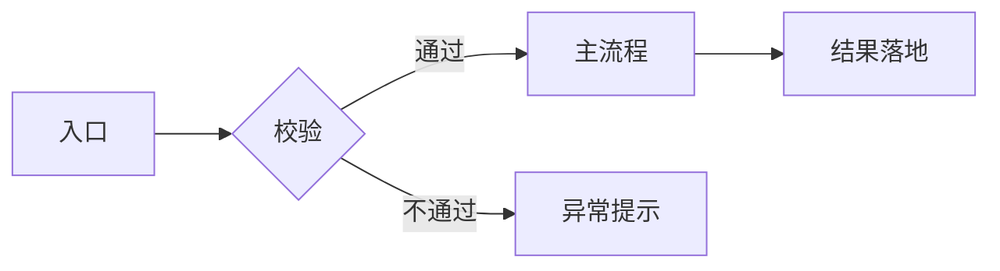

# 需求文档模板

> **用途**：把 PRD / 飞书文档 / 口头需求转成可开发、可验收、可追溯的 `01-requirements.md`。
> **AI 友好设计**：占位符分三类——`<!-- AI:auto:... -->`（AI 扫代码库自动填）、`<!-- AI:fill:... -->`（AI 按填写指引生成，事实需人确认）、`<!-- 手动填写:... -->`（必须人工提供）。生成后按 SKILL.md「生成后自检」核对，无需人工逐项追问。
> **章节约定**：`[必填]` = 必须填写；`[选填]` = 有则填、无则标注"本期无"后跳过；`[AI-auto]` = AI 可从 PRD/代码库自动推导。
> **阶段边界**：本文档只写「要什么（What）」，不写「怎么做（How）」。接口清单 / DTO / 数据模型 / 建表属于技术方案文档（见 `tech-design-doc-template.md`）。

---

| 字段 | 值 |
|------|-----|
| 需求 ID | <!-- 例如：REQ-20261027-XXX --> |
| 需求名称 | <!-- 一句话概括 --> |
| 文档版本 | <!-- v0.1 --> |
| 需求提出人 | <!-- 产品/业务方 --> |
| 研发负责人 | <!-- --> |
| 更新时间 | <!-- YYYY-MM-DD --> |
| 当前状态 | 草稿 / 评审中 / 已签收 / 已作废 |

---

## 一、简介 `[必填]`

<!-- AI:fill:2-3 段话讲清楚三件事：① 现状是什么、痛点在哪；② 本期要解决到什么程度；③ 明确不解决什么 -->

### 1.1 本期范围

<!-- AI:fill:从 PRD 提取"纳入"与"不纳入"清单。不纳入项必须写明原因，防止后续扯皮 -->

| 纳入 | 不纳入 |
|------|--------|
| <!-- AI:auto:本期要做的功能点 --> | <!-- AI:auto:明确排除的功能点 + 排除理由 --> |

### 1.2 数据口径

<!-- AI:fill:从 PRD 提取涉及的核心字段/枚举/单位/精度/空值语义。金融业务必填，普通展示需求可跳过 -->

| 项 | 结论 |
|----|------|
| <!-- 例如：币种字段 --> | <!-- 例如：ISO 4217 三位码，大写；空值视为未知币种，不默认 USD --> |
| <!-- 例如：金额精度 --> | <!-- 例如：法币 2 位小数，虚拟币 6 位小数，四舍五入 HALF_UP --> |

---

## 二、需求来源 `[必填]`

> **防臆造铁律**：本文档每一条需求都必须能回溯到本节列出的来源。标「PRD 原文」的必须是「文件名 + 章节号 + 原文摘录」三要素齐全，缺一即降级为「推断 · 待确认」。

### 2.1 核心 PRD

| 字段 | 值 |
|------|-----|
| 文件名 | <!-- 例如：RWA产品首页_PRD_v2.md --> |
| 一手地址 | <!-- 飞书链接 / GitLab 仓库地址 + 分支 + 路径 --> |
| 关联章节 | <!-- 例如：§5.3 首页布局、§6.4 搜索匹配规则 --> |

### 2.2 关联 PRD 与参考材料

| 关联说明 | 文档/材料 | 引用章节/说明 |
|---------|----------|-------------|
| <!-- 例如：搜索共享口径 --> | <!-- 例如：RWA产品货架及产品详情_PRD_v2.md --> | <!-- 例如：§7.2 搜索匹配规则 --> |
| <!-- 例如：UI 参考稿 --> | <!-- 例如：assets/rwa-homepage.jpg --> | <!-- 例如：首页布局、搜索结果态 --> |

<!-- AI:fill:关联说明应简明概括该材料对本需求的贡献点，引用章节精确到 §编号。UI 稿/泳道图/多语言文案均属于参考材料，不得标成 PRD 原文 -->

---

## 三、用户故事与验收标准 `[必填]`

> **格式固定**：每条用户故事一段「作为…我希望…以便…」+ 一组 EARS 语式的验收标准。验收标准是后续单测与联调的输入，必须可执行、可判定。

### US-1: <!-- 用户故事标题 -->

**作为** <!-- 角色，例如：白标租户运营 -->
**我希望** <!-- 能力 -->
**以便** <!-- 业务价值 -->

**验收标准：**

- 当 <!-- 触发条件 --> 时，系统应当 <!-- 行为 -->。
- 当 <!-- 异常/边界条件 --> 时，系统应当 <!-- 兜底行为 -->。

### US-2: <!-- 用户故事标题 -->

<!-- AI:fill:按需复制上面的块。验收标准优先使用「当…时，系统应当…」句式；避免"等/相关/适当"这类无法判定的词 -->

---

## 四、EARS 需求表 `[必填]`

<!-- AI:fill:把每个功能点归入 EARS 五类之一，逐条编号。类别=Ubiquitous/Event-Driven/State-Driven/Optional/Exceptional -->

| ID | EARS 类别 | 需求描述 | 优先级 | 来源 | 追问状态 |
|----|----------|---------|--------|------|---------|
| REQ-01 | Event-Driven | 当 <!-- --> 时，系统应当 <!-- --> | P0 | 【来源: PRD <文件名> §<章节> "<原文摘录≤20字>"】 | 已闭环 |
| REQ-02 | Exceptional | 当 <!-- --> 失败时，系统应当 <!-- --> | P1 | 【来源: 推断 · 待确认】 | 待追问 |

**来源标签取值**（四选一，不得自创）：

| 标签 | 用于 | 硬要求 |
|------|------|--------|
| `【来源: PRD <文件名> §<章节> "<原文摘录≤20字>"】` | PRD 正文需求 | 三要素齐全可复核 |
| `【来源: UI稿 <文件名>】` | UI 设计稿元素 | 不得写成 PRD 原文 |
| `【来源: 代码 <文件:行>】` | 代码实证 | 路径须经验证真实存在 |
| `【来源: 推断 · 待确认】` | 主观推断 / 反推 | 严禁伪装成上面三种 |

---

## 五、业务流程 `[选填]`

<!-- AI:auto:从 PRD 流程描述或代码调用链推导，用 Mermaid 绘制。单点功能可标注"本期无新增流程" -->

---

## 六、自审缺陷清单 `[必填]`

<!-- AI:fill:对 EARS 表做系统性扫描，标记五类缺陷：遗漏边界场景 / 模糊措辞 / 未指定异常处理 / 非功能需求缺失 / 隐性假设 -->

| # | 缺陷类型 | 涉及需求 | 严重度 | 处理状态 |
|----|---------|---------|--------|---------|
| 1 | 遗漏边界场景 | REQ-0X | 高 | 已追问闭环 / 待产品确认 |

---

## 七、追问答案归档 `[必填]`

> **五层追问**：答案写结论，不写过程。无法闭环的问题一律转「阻塞项」章节。

### 第一层：Why

- <!-- 为什么做？为什么现在做？不做会怎样？ -->

### 第二层：What Not

- <!-- 什么不做？边界在哪？前置条件是什么？ -->

### 第三层：When Wrong

- <!-- 失败了怎么办？部分成功怎么办？用户看到什么？ -->

### 第四层：Who & Where

- <!-- 谁受影响？哪些系统/页面受影响？上下游依赖？ -->

### 第五层：How Deep

- <!-- 隐性假设？精度/序列化/时区约束？审批超时？ -->

---

## 八、非功能需求 `[必填]`

| 类别 | 需求 | 约束值 |
|------|------|--------|
| 性能 | <!-- 例如：列表接口响应 --> | <!-- 例如：P99 < 500ms --> |
| 可用性 | <!-- --> | <!-- --> |
| 安全 | <!-- 例如：越权访问 --> | <!-- 例如：按 tenantId 隔离，跨租户拒绝 --> |
| 合规 | <!-- 例如：审计留痕 --> | <!-- 例如：关键操作保留 5 年 --> |
| 兼容性 | <!-- 例如：存量数据 --> | <!-- 例如：历史空值按"未知"处理，不回填 --> |

---

## 九、术语对照表 `[必填]`

> 金融业务同义词极易混淆，尤其身份类字段（customerId / accountId / subAccountId）必须逐个钉死。

| 术语 | 定义 | 本需求口径 | 来源 |
|------|------|-----------|------|
| <!-- 例如：星财号 --> | <!-- 客户唯一标识 --> | <!-- 本需求使用 customerId --> | PRD §X / glossary.md |

---

## 十、约束条件与假设 `[选填]`

| # | 类型 | 内容 | 若不成立的影响 |
|----|------|------|---------------|
| 1 | 假设 | <!-- 例如：上游 FinMix 已提供该字段 --> | <!-- 例如：本期无法实现，需降级 --> |
| 2 | 约束 | <!-- 例如：仅 FLF 租户启用，FeatureFlag 门控 --> | <!-- --> |

---

## 十一、阻塞项 `[必填]`

> **门禁**：涉及资金 / 资产 / 权限变更的需求，P0 阻塞项未闭环前禁止进入设计或编码阶段。

| # | 问题 | 阻塞等级 | 影响范围 | 传导链 | 建议动作 |
|----|------|---------|---------|--------|---------|
| 1 | <!-- --> | P0 | <!-- --> | <!-- 例：阻塞 REQ-01 下单 + REQ-03 持仓查询 --> | <!-- 找谁确认 --> |

**阻塞等级定义**：P0（阻断，核心功能无法实现）/ P1（严重，影响 ≥2 个需求项）/ P2（一般，体验降级或单点边界缺失）。

---

## 十二、AI 友好度评分卡 `[必填]`

| 维度 | 分数(1-5) | 证据 | 改进建议 |
|------|-----------|------|---------|
| 术语一致性 | <!-- --> | <!-- 同义词冲突数量+类型 --> | <!-- --> |
| 模糊度 | <!-- --> | <!-- 模糊措辞数量+位置 --> | <!-- --> |
| 结构化程度 | <!-- --> | <!-- EARS 覆盖率% --> | <!-- --> |
| 来源可复核性 | <!-- --> | <!-- 来源标签覆盖率% --> | <!-- --> |
| 阻塞点清晰度 | <!-- --> | <!-- 阻塞项数量+等级分布 --> | <!-- --> |
| **总评分** | **<!-- /25 -->** | — | — |

> **阈值**：≥20 可进入下游；15-19 建议先解决 ≤3 分的维度；<15 建议暂停补充需求信息。

**评分锚点**（打分只认证据，不凭感觉）：

| 维度 | 1 分 | 3 分 | 5 分 |
|------|------|------|------|
| 术语一致性 | 同一对象 ≥3 种叫法，无对照表 | 术语表已建，个别字段口径待确认 | 身份类/金额类字段全部钉死并有来源 |
| 模糊度 | 大量"等/相关/适当/尽快" | 模糊措辞仅出现在非功能项 | 每条需求均可判定真/假 |
| 结构化程度 | 需求为段落叙述 | EARS 覆盖 ≥60% | EARS 覆盖 100%，五类齐全 |
| 来源可复核性 | 大量推断未标注 | 标签覆盖 ≥70% | 全部标源，PRD 类三要素齐全 |
| 阻塞点清晰度 | 阻塞项未分级 | 已分级，缺传导链 | 分级 + 传导链 + 建议动作齐全 |

---

## 附录：文档变更记录

| 版本 | 日期 | 作者 | 变更说明 |
|------|------|------|---------|
| v0.1 | <!-- --> | <!-- --> | 初版 |
